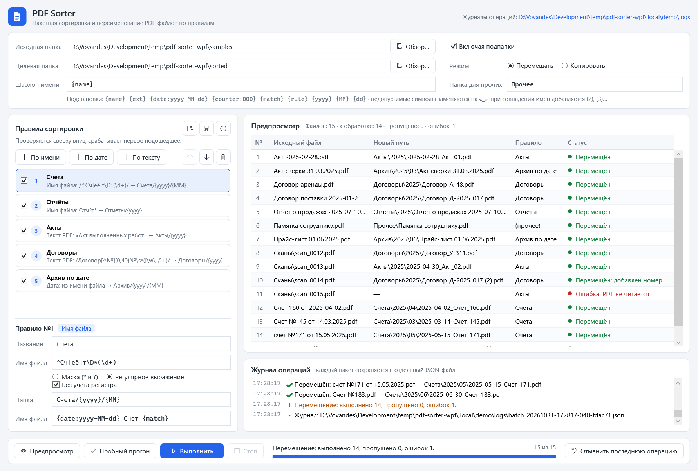
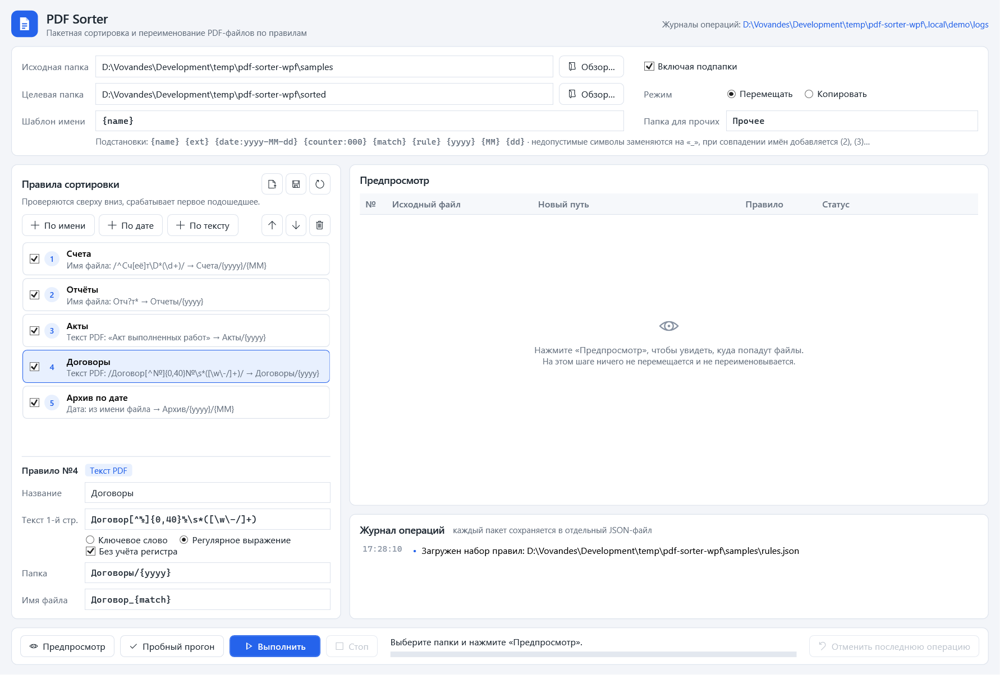
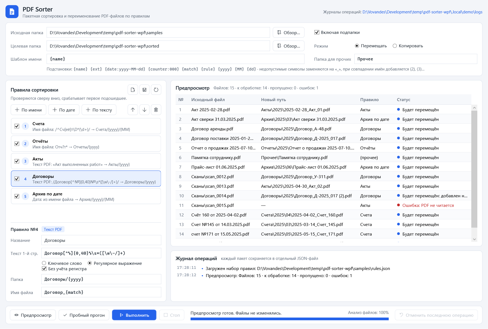

# PDF Sorter — пакетная сортировка и переименование PDF

Настольная утилита для Windows: раскладывает сотни PDF-файлов (счета, договоры, акты, сканы) по папкам и даёт им
единообразные имена по настраиваемым правилам. Перед выполнением показывает подробный план, а любую операцию
можно отменить одной кнопкой.



## Что умеет

- **Правила трёх типов, по порядку, срабатывает первое подошедшее:** маска или регулярное выражение по имени файла
  (`Счет_*` → `Счета/`), дата из имени или дата изменения (`2025-03-14`, `14.03.2025` → `{yyyy}/{MM}`),
  ключевое слово или regex по тексту первой страницы PDF — например, номер договора попадает прямо в новое имя.
- **Шаблоны имён:** `{name}`, `{date:yyyy-MM-dd}`, `{counter:000}`, `{match}`, `{ext}`; недопустимые символы
  заменяются на `_`, при совпадении имён добавляется `(2)`, `(3)`…
- **Безопасность:** предпросмотр «исходный файл → новый путь → правило → статус», пробный прогон (dry run),
  перемещение или копирование с прогресс-баром и кнопкой «Стоп», **«Отменить последнюю операцию»** по журналу.
- **Журнал операций** в JSON (`%LOCALAPPDATA%\PdfSorter\logs\`) и в окне программы; наборы правил сохраняются в JSON.
- **Устойчивость к ошибкам:** битый PDF, занятый файл или нет прав — строка помечается ошибкой, остальные файлы
  обрабатываются дальше.

## Скриншоты

| Правила и редактор | Предпросмотр плана |
|---|---|
|  |  |

Пример журнала выполненного пакета: [docs/journal_example.json](docs/journal_example.json).
Скриншоты настоящие: их снимает скрипт `tools/make-screenshots.ps1` на демо-наборе из 15 PDF.

## Стек

C# 12 · .NET 8 · WPF · MVVM (CommunityToolkit.Mvvm) · PdfPig (чтение текста PDF) ·
System.IO.Abstractions (файловая система за интерфейсом) · xUnit.

## Установка и запуск

Нужны Windows 10/11 и .NET SDK 8 или новее. Команды PowerShell из корня репозитория:

```powershell
dotnet build PdfSorter.sln -c Release
dotnet run --project src/PdfSorter.App
```

Демо-набор (15 PDF: счета, договоры, акты, отчёт, повреждённый файл) и файл правил к нему:

```powershell
dotnet run --project tools/PdfSorter.SampleGenerator -- samples
```

В программе укажите исходную папку `samples`, целевую — например, `sorted`, нажмите «Предпросмотр», затем
«Выполнить». Правила по умолчанию совпадают с `samples\rules.json`.

Сборка для передачи пользователю (нужен установленный .NET 8 Desktop Runtime):

```powershell
dotnet publish src/PdfSorter.App -c Release -r win-x64 --self-contained false -o publish
```

Для Visual Studio — решение `PdfSorter.sln` (классический формат); сборка проверена и через MSBuild из Visual Studio 2026.

## Тесты

```powershell
dotnet test PdfSorter.sln -c Release
```

115 тестов (60 тестовых методов) на ядро: маски и regex, даты из имени и шаблоны папок, правила по тексту
(через подставной `IPdfTextReader`), шаблоны имён, очистка символов и конфликты имён, пробный прогон не меняет
файловую систему, выполнение, остановка и отмена пакета (на `MockFileSystem`), интеграционный тест PdfPig на PDF,
созданном прямо в тесте.

Полный демо-сценарий с проверками (dry run не меняет файлы, отмена возвращает всё на место) и пересъёмкой
скриншотов:

```powershell
.\tools\make-screenshots.ps1
```

## Структура проекта

```
PdfSorter.sln
src/
  PdfSorter.Core/        ядро без WPF: правила, шаблоны имён, планировщик, исполнитель, журнал, отмена
    Rules/               FileNameRule, DateRule, PdfTextRule, набор правил и его JSON
    Naming/              шаблоны {name}/{date}/…, очистка имён, подбор свободного имени
    Planning/            SortPlanner — строит план, ничего не меняя на диске
    Execution/           SortExecutor (перемещение/копирование, dry run, отмена), UndoService
    Journal/             модель журнала и хранилище JSON
    Pdf/                 IPdfTextReader и реализация на PdfPig
  PdfSorter.App/         WPF: MainWindow, ViewModels, диалоги, тема оформления, режим скриншотов
tests/
  PdfSorter.Core.Tests/  xUnit-тесты ядра
tools/
  PdfSorter.SampleGenerator/  генератор демо-PDF
  make-screenshots.ps1        демо-прогон и скриншоты для docs/
docs/                    скриншоты и пример журнала
```

## Лицензия

[MIT](LICENSE) © 2026 Vladimir
